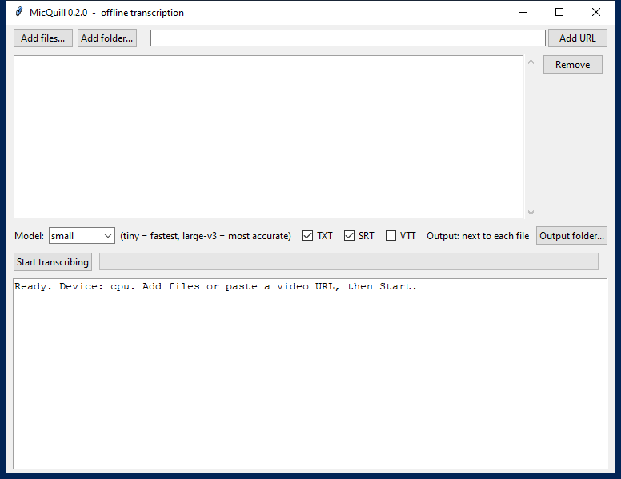

# MicQuill - offline transcription for Windows

Drop in audio or video files, or paste a video link, and get clean transcripts (TXT) and subtitles (SRT/VTT).
Everything runs on your own PC: no account, no upload, no per-minute fees. CPU only, no graphics card needed.

**Free while in beta.** Download below, try it, and tell us what breaks or what you wish it did:
open an [Issue](https://github.com/kennsAtlas/MicQuill/issues). Honest feedback is the whole point of this release.

## Download
Latest build: see [Releases](https://github.com/kennsAtlas/MicQuill/releases) (`MicQuill-0.2.1-win64.zip`, about 600 MB; the `small`
speech model is inside, so the first run needs no internet).

SHA-256 of the 0.2.1 zip: `CEF098DC9612668874169FA431571D358046276A1824FAD21B09D93B2D6E2770`

## Use
1. Unzip anywhere and run `MicQuill.exe`.
2. **Add files...**, **Add folder...**, or paste a link and click **Add URL**.
3. Keep the `small` model (built in) or pick `medium` / `large-v3` for more accuracy (those download once).
4. **Start transcribing.** Transcripts are saved next to each file (or in the folder you choose).

Command line: `MicQuill.exe --cli "C:\clips\talk.mp4" --model small --formats txt,srt`

## First launch on Windows
MicQuill is a small independent app and is not yet code-signed, so Windows SmartScreen may show "Windows protected your PC"
the first time. Click **More info**, then **Run anyway**. Windows asks only once. Compare the SHA-256 above if you want to
verify the download.

## Requirements
Windows 10/11, 64-bit. About 1 GB of disk. No GPU needed.

## Privacy
Files never leave your machine. Links are downloaded to your temp folder and processed locally. No telemetry.

## Licenses
MicQuill itself: see [LICENSE.txt](LICENSE.txt). Built on open-source components (FFmpeg LGPL, faster-whisper MIT,
Whisper MIT, Silero VAD MIT, and the Systran Whisper weights, MIT): see [THIRD_PARTY_NOTICES.txt](THIRD_PARTY_NOTICES.txt).
